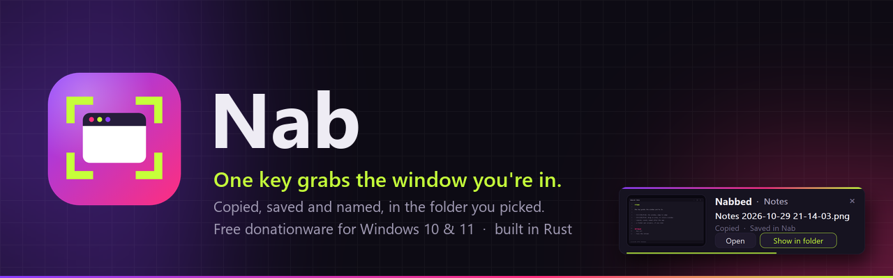
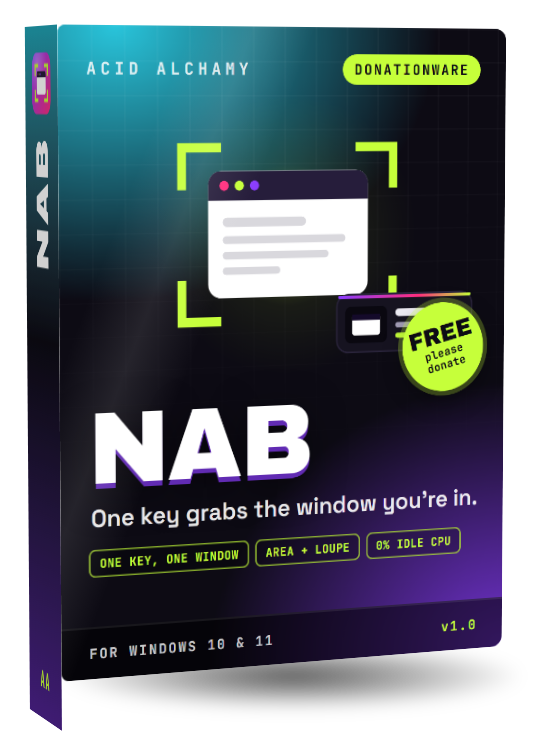
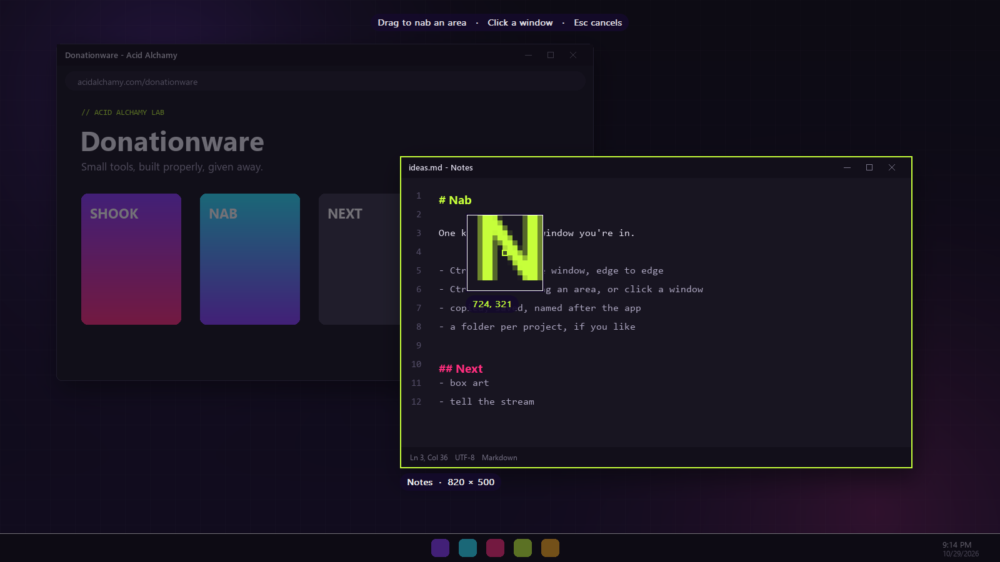
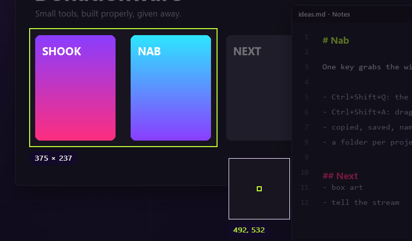
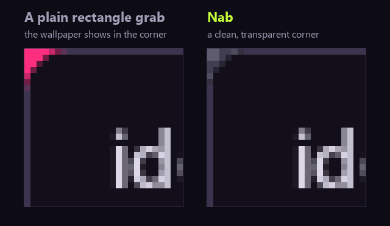
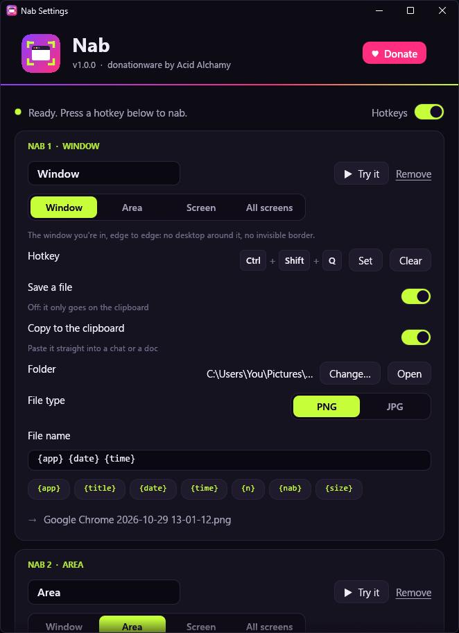
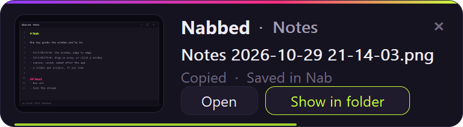

<div align="center">

<a href="https://acidalchamy.com/donationware/nab/"></a>

<br>

<a href="https://github.com/AcidAlchamy/nab/releases/latest/download/Nab.exe"></a>
&nbsp;
<a href="https://acidalchamy.com/donationware/nab/?from=github#donate"></a>

<br><br>

<a href="https://github.com/AcidAlchamy/nab/releases/latest"></a>


</div>

<br>

<table>
<tr>
<td width="44%" valign="top" align="center">

</td>
<td valign="top">

### One key grabs the window you're in.

Press <kbd>Ctrl</kbd>+<kbd>Shift</kbd>+<kbd>Q</kbd> and the window you're working in is
**copied** to the clipboard and **saved** to a folder, edge to edge, named after the app and
the time: `Google Chrome 2026-10-29 21-14-03.png`. Paste it into a chat, a ticket or a doc,
or find it later in a folder that reads like a list.

Want just a piece of the screen? <kbd>Ctrl</kbd>+<kbd>Shift</kbd>+<kbd>A</kbd> freezes it:
drag out an area, or click any window to nab exactly that window.

**Built light, on purpose: that's why it exists.** Nab is one 4.7 MB exe with no installer.
It hands its hotkeys to Windows and goes to sleep: **0% CPU** while it waits and about
**2 MB** of memory. Nothing polls, nothing hooks your keyboard, nothing phones home.

**Nab is donationware.** It's free to use, for good: no trial, no locked features,
no account. If it earns its place on your keyboard, a [small donation](https://acidalchamy.com/donationware/nab/?from=github#donate)
keeps the lab building more tools like it.

</td>
</tr>
</table>

---

## ✦ What it does

| | |
|---|---|
| **Featherweight** | Plain Win32 in Rust that sleeps until you press a key: **zero CPU** while it waits, about **2 MB** of memory, no keyboard hooks, no polling. The settings window only exists while it's open. |
| **The window, exactly** | Nab asks Windows for a window's *visible* edges, so you get the window and nothing else: no strip of desktop, no invisible resize border. |
| **Clean corners on Windows 11** | Windows 11 rounds its windows; Nab makes the bits outside the curve transparent instead of keeping the wallpaper that was behind them. |
| **An area, or a window you click** | The screen freezes and dims. Drag out a rectangle, or hover a window (it lights up with its name and size) and click. A **loupe** magnifies the pixels under the pointer; the arrow keys nudge one pixel. |
| **Copied and saved at once** | On the clipboard as a classic bitmap *and* as PNG (browsers, Discord, Slack and editors keep the transparency), and in your folder as PNG or JPG. |
| **Named so you can find it** | A file-name pattern per nab: `{app} {date} {time}` by default, with `{title}`, `{n}`, `{size}` and more. Slashes make subfolders: `{app}/{date} {n}` sorts by app. |
| **A hotkey per job** | Each **nab** is a hotkey with its own kind, folder and name. *Bug reports* to one folder, *Design* to another, screenshots for chat clipboard-only. Up to twelve. |
| **A card, not a pop-up** | A small preview slides into the corner: the picture, the file, **Open** and **Show in folder**. It never takes the keyboard from your app and leaves by itself. |

<p align="center"></p>

<p align="center"><sub>The area picker over a made-up desktop, drawn by Nab's own code: the window under the pointer is lit with its name and size, and the loupe shows the exact pixel.</sub></p>

<table>
<tr>
<td width="56%" valign="top"></td>
<td valign="top"></td>
</tr>
</table>

## ✦ A look inside

<table>
<tr>
<td width="50%" valign="top"></td>
<td valign="top">

**Settings** (right-click the tray icon, or run `Nab.exe` again):

- **Nabs**: each one has a name, a kind (*Window*, *Area*, *Screen*, *All screens*), a hotkey, a folder, PNG or JPG, a file-name pattern with a live preview, and **Try it**.
- **After each nab**: the preview card, a quick flash, a soft shutter sound, the mouse pointer in the picture, and the Windows 11 corner clean-up.
- **Behavior**: *Start with Windows*, the hello card, and a command to copy for Stream Deck buttons and shortcuts.

Every change saves on its own; there's no Save button.

<br>

**The card** after each nab (it fades away after five seconds, or stays while you point at it):



</td>
</tr>
</table>

## ✦ Get started

1. **[Download `Nab.exe`](https://github.com/AcidAlchamy/nab/releases/latest/download/Nab.exe)** and run it. There's nothing to install.
2. Windows may say it doesn't recognize the publisher yet (Nab isn't code-signed). Choose **More info**, then **Run anyway**.
3. Nab settles into your tray (bottom right, maybe under the <kbd>^</kbd> arrow) and opens its settings once to say hello.
4. Press <kbd>Ctrl</kbd>+<kbd>Shift</kbd>+<kbd>Q</kbd> in any window. Paste it anywhere, or open **Pictures\Nab**.
5. Want it every time? Turn on **Start with Windows** in the settings.

### Out of the box

| Nab | Key | What it takes |
|---|---|---|
| **Window** | <kbd>Ctrl</kbd>+<kbd>Shift</kbd>+<kbd>Q</kbd> | The window you're in, edge to edge |
| **Area** | <kbd>Ctrl</kbd>+<kbd>Shift</kbd>+<kbd>A</kbd> | An area you drag out, or a window you click |
| **Screen** | *(tray menu)* | The whole screen the pointer is on |

Everything saves to **Pictures\Nab** and goes on the clipboard. Change any of it, or add more nabs, in the settings.

### The tray menu

Right-click the icon: every nab with its hotkey · **Open the last nab** · **Open the Nab folder** · **Pause hotkeys** · **Settings…** · **Donate ♥** · **Nab on the web** · **Quit Nab**.
Left-click opens the settings.

### Stream Deck, shortcuts and scripts

```
Nab.exe --nab 1          take nab 1 from the settings (2, 3… for the others)
Nab.exe --nab window     the window you're in
Nab.exe --nab area       the area picker
Nab.exe --nab screen     the screen the pointer is on
Nab.exe --nab all        every screen
```

It starts Nab first if it isn't running. *Settings › Behavior › Copy the command* puts the full path on your clipboard, ready for a Stream Deck *Open* action.

### System requirements

| | |
|---|---|
| **System** | Windows 10 or 11, 64-bit |
| **Processor** | Anything that runs Windows 10 |
| **Memory** | About 2 MB while it waits (a few MB after a run of nabs) |
| **Disk** | One 4.7 MB file |
| **Graphics** | OpenGL 2 for the settings window (any GPU from the last decade) |
| **Displays** | Any number, any mix of scaling (per-monitor DPI aware: a 150% screen gives a sharp 150% picture) |

## ✦ File names

The pattern is set per nab. Tokens:

| Token | Becomes |
|---|---|
| `{app}` | The app's own name, as the program describes itself: `Google Chrome`, `Notepad`, `Windows Explorer` |
| `{title}` | The window's title |
| `{date}` | `2026-10-29` |
| `{time}` | `21-14-03` |
| `{n}` | `1`, `2`, `3`… the lowest number not taken yet in that folder |
| `{nab}` | The nab's name from the settings |
| `{size}` | `1280x720` |

A `/` or `\` makes a subfolder. Characters Windows won't allow are swapped for spaces, and a name that already exists gets ` (2)`.
Area nabs use `Area` as the app (or the app of a window you clicked), screen nabs `Screen`, all-screen nabs `Desktop`.

## ✦ Light, measured

Light is the point of Nab, so here are the numbers, read from Windows' own counters:

| | |
|---|---|
| Waiting for a hotkey | **0% CPU**: about 3 M CPU cycles in 10 seconds (ThinkPad i5-10310U, Windows 11 24H2) |
| Private memory at rest | **2.1 MB** (i7-12700 desktop, Windows 11) |
| Private memory after a run of nabs | **6.2 MB** (the ThinkPad; the last picture stays ready for pasting as a PNG) |
| The exe | **4.7 MB**, one file, no installer |
| While the card is up | a redraw 8 times a second; frames only while it fades |

How it stays that light:

- The always-running part is plain Win32: a hidden window with one `RegisterHotKey` per nab, blocked in `GetMessage` until a key is pressed. No keyboard hooks, no polling, no timers.
- A window nab copies only that window's pixels (`BitBlt` of its `DWMWA_EXTENDED_FRAME_BOUNDS`). The area picker takes one picture of the whole desktop, so what you drag over is exactly what you saw when you pressed the key.
- PNG and JPEG encoding and the file write happen on a short-lived thread. The clipboard gets its PNG from the same encode, and the raw pixels are let go of as soon as it exists.
- The card and the picker are drawn by Nab's own little renderer into layered windows; the settings window and the hello card are separate, short-lived processes of the same exe (egui).

## ✦ Settings file

Everything lives in `%APPDATA%\Nab\settings.toml` (the settings window writes it; you can edit it by hand, then choose *Settings* in the tray to reload).

| Key | Default | Meaning |
|---|---|---|
| `paused` | `false` | Hotkeys do nothing (the tray menu still works) |
| `card` | `true` | The preview card after each nab |
| `flash` | `true` | A quick white flash over what was nabbed |
| `sound` | `false` | A soft shutter click |
| `pointer` | `false` | Draw the mouse pointer into window and screen nabs |
| `corners` | `true` | Windows 11: make the corners outside a window's rounded edge transparent |
| `jpg_quality` | `90` | `50` to `100` |
| `hello_card` | `true` | The donationware note when Nab starts |
| `[[nabs]]` | three | One table per nab: `name`, `kind` (`window`, `area`, `screen`, `all-screens`), `hotkey` (like `"Ctrl+Shift+Q"`, empty for none), `folder` (empty = Pictures\Nab), `pattern`, `format` (`png`, `jpg`), `save`, `copy` |

## ✦ Build it yourself

```
git clone https://github.com/AcidAlchamy/nab
cd nab
cargo build --release      # target/release/nab.exe
cargo test
```

Needs Rust 1.85 or newer and the MSVC build tools. The art is reproducible: `python art/icons.py` renders the icons
(Chrome or Edge + Pillow), `python art/mock.py` draws the made-up desktop, `cargo test demo -- --ignored` with
`NAB_DEMO=art/build` draws the picker and the card over it with Nab's own code, and `python art/readme.py` builds
these pictures.

## ✦ Donationware

Nab is free and open source under the [MIT license](LICENSE). Use it at home, at work, on every PC you own.
If it saves you time, please consider a [donation](https://acidalchamy.com/donationware/nab/?from=github#donate):
it's what pays for the next tool on the [Donationware shelf](https://acidalchamy.com/donationware/).

<div align="center">
<br>
<sub>Made by <a href="https://acidalchamy.com">Acid Alchamy</a> · see also <a href="https://github.com/AcidAlchamy/shook">Shook</a>, the mouse finder</sub>
</div>
